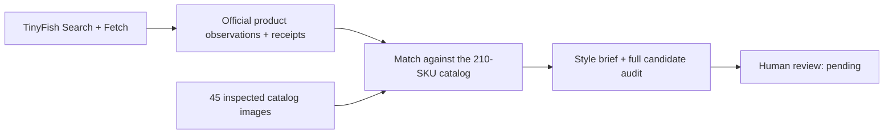

# Kinbor Retailer Intelligence

**Research independent retailers with TinyFish, then connect their assortments to 210 real stationery SKUs—with sources, carton constraints and uncertainty visible.**

A brand entering US retail needs to know which products merit a buyer's review. A store selling notebooks is only a starting point; category overlap alone cannot establish design fit or buying intent.

**Open first:** [Atlas product brief](examples/retailers/atlas/style_brief.md) · [5-minute demo](docs/DEMO.md) · [Architecture](docs/ARCHITECTURE.md)

## How it works



Search discovers URLs; fetched official pages support observations. The rules baseline requires a compatible product format and specific shared design traits. It can abstain; it does not fill a recommendation quota.

## Three real-site research pilots

| Saved example | Product observations | Shown review candidates |
|---|---:|---|
| [Atlas Stationers](examples/retailers/atlas/style_brief.md) | 7 | 1 translucent pouch hypothesis |
| [Shorthand](examples/retailers/shorthand/style_brief.md) | 6 | 4 notebook hypotheses, from 8 supported review candidates |
| [Wonder Fair](examples/retailers/wonder-fair/style_brief.md) | 6 | 0 — insufficient evidence in the inspected subset |

Each store retains an audit of **all 210 SKUs**. These are public-website research pilots, not retailer partnerships or commercial deployments. [Evidence and baseline guide](examples/README.md).

## Project structure

```text
catalog/    210-SKU snapshot, 210 images and preserved importer
kinbor/     TinyFish client, research, matching and evaluation code
examples/   Three store bundles, frozen baselines and pending reviews
docs/       Architecture, demo, API contract and evaluation protocol
scripts/    Read-only repository verification
tests/      Offline tests and synthetic transport fixtures
```

## Run the saved demo

Python **3.10+**, from the repository root; no credentials or package installation needed.

```bash
python3 scripts/verify_repository.py
python3 -m unittest discover -v
python3 -m kinbor.matching --pilot-dir examples/retailers/atlas --validate
```

The verifier checks the original **214 Phase 1 hashes**, SKU/image joins, saved evidence and local documentation links. Follow the [demo walkthrough](docs/DEMO.md) or [live TinyFish setup](docs/TINYFISH_API.md). Pillow is only needed for an authorized private-source image rebuild; see [catalog guide](catalog/README.md).

## What remains unvalidated

**MULTIMODAL LIVE NOT VALIDATED.** Only 45/210 catalog images have analyst notes pending human review; retailer image pixels were not assessed. All **36 human-comparison rows are blank**. Selection quality, time savings, buyer acceptance and sales conversion have not been measured.

Current product evidence came from connected TinyFish Search/Fetch; adjacent REST receipts belong to older frozen runs. New REST product mode is mock-tested, not freshly authenticated live. Each SKU requires a separate full carton under the project rule; stock, pricing, rights and buyer/supplier acceptance remain unverified. Private supplier files and credentials are excluded. [Full boundaries and provenance](docs/ARCHITECTURE.md) · [Frozen baselines](docs/BASELINES.md).
