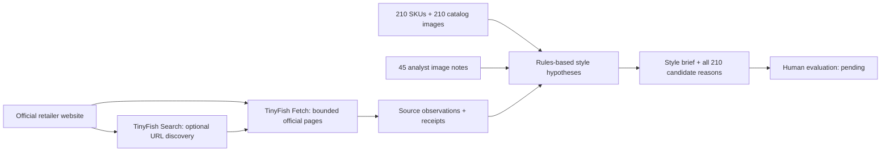

# Kinbor Retailer Intelligence

**Turn public retailer research into evidence-linked SKU hypotheses for human review.** Built around TinyFish research and a preserved **210-SKU stationery catalog with 210 product images**.

## Problem

A stationery brand exploring US independent retail needs more than a list of stores. Someone must inspect each store's assortment, connect it to actual products, track source evidence and expose ordering constraints. A shared category such as “notebooks” does not establish design fit, buyer interest or willingness to buy a full carton.

This prototype makes that research inspectable: **TinyFish discovery and Fetch → official product observations → catalog matching → a source-linked style brief and complete candidate audit**. A person remains responsible for product judgement and commercial decisions.

**Start here:** [Atlas brief](phase2/live/atlas/style_brief.md) · [5-minute demo](docs/DEMO.md) · [Architecture](docs/ARCHITECTURE.md) · [Evidence map](phase2/README.md)

## Three actual-site research pilots

These are saved observations of real public websites, not retailer partnerships or customer deployments. Snapshot: November 9, 2026 in Chicago / November 10 UTC.

| Retailer | Product observations | Shown review candidates | What the example demonstrates |
|---|---:|---|---|
| [Atlas Stationers](phase2/live/atlas/style_brief.md) | 7 | `DT55566` | Translucent pouch hypothesis tied to a specific Hightide case listing; construction, dimensions and 100-unit carton acceptance remain unverified. |
| [Shorthand](phase2/live/shorthand/style_brief.md) | 6 | `DT54744`, `DT54726`, `DT54729`, `DTYC0006` | Checker/geometric and botanical notebook hypotheses; artwork, foil, binding and other details differ or need review. |
| [Wonder Fair](phase2/live/wonder-fair/style_brief.md) | 6 | None | Insufficient support in the inspected subset; the matcher abstains instead of filling a quota. |

Each `matching.json` retains **all 210 SKUs**. Shorthand has eight supported hypotheses requiring human review; the default display cap shows four. Unannotated SKU images are unassessed, not negative examples.

**Current validation boundary:** `MULTIMODAL LIVE NOT VALIDATED`. Only **45/210 catalog images** have local Codex inspection notes, labelled analyst inference and pending human review. Retailer image URLs were observed; their pixels were not assessed. The **36 A/B review rows remain blank**. No measured selection-quality gain, saved time, buyer acceptance, sales or conversion result is available.

## TinyFish research pipeline



The current product-evidence pilot used connected TinyFish **Search/Fetch** tools: 2 Search + 9 Fetch calls, 38 URL requests including repeats, 37 successful results and one discovery 404. Shared receipts must not be counted twice. Older direct Python REST runs are preserved separately in adjacent `api_receipt.json` files. The new REST product mode is **mock-tested, not freshly authenticated live**; billed costs remain Unknown. See the [API contract and provenance](docs/TINYFISH_API.md).

Matching requires an inspected SKU image, a specific official retailer product observation, a compatible functional format and sufficiently specific shared design features. Generic “plain cover” is insufficient, and a refill cannot substitute for a notebook without compatibility evidence. SKU order only stabilizes equal-evidence display. This conservative rules baseline supports abstention; its quality has not been established by human evaluation.

## Quickstart: offline, no credentials

Use **Python 3.10+** from the repository root. Saved-output validation and all existing tests use the standard library. Pillow is optional for rebuilding catalog images from private source workbooks; it is not needed for this demo.

```bash
git clone https://github.com/dreamsova/kinbor-retailer-intelligence.git
cd kinbor-retailer-intelligence
python3 -m unittest discover -v
python3 scripts/verify_repository.py
```

The verifier checks the 214 preservation hashes, catalog/image joins, all three frozen research bundles, current style outputs, review status and local documentation links. It reads saved files without refreshing them or calling a service. Follow the [demo walkthrough](docs/DEMO.md) to inspect one candidate, one abstention and the evaluation gap.

For fresh research, securely inject `TINYFISH_API_KEY` into the process environment, then write to an ignored scratch directory:

```bash
python3 research.py --mode tinyfish --url https://www.atlasstationers.com/ \
  --product-evidence --max-pages 10 --output-dir work/atlas-new
```

This is a live API command and can incur provider charges. Missing credentials fail before transport with a blocked receipt. Search discovers URLs, never assortment facts. Linked shop domains require official linkage evidence; account/cart/checkout actions are excluded. See [configuration, limits and error handling](docs/TINYFISH_API.md).

## Repository map

```text
README.md                    Project story and entry points
research.py                  Acquisition, normalization and saved-bundle validation
tinyfish_client.py           Direct TinyFish REST transport
matching.py / vision.py      Rules baseline / optional image-model adapter
phase2.py / eval.py           Historical joins and review queue / evaluation tooling
products.csv / images/       Frozen 210-SKU catalog and 210 WebPs
import.py / test_import.py   Frozen Phase 1 importer and catalog tests
tests/                      Remaining offline tests and shared fixtures
scripts/verify_repository.py Read-only preservation and evidence checks
phase2/                     Current style outputs beside frozen research evidence
docs/                       Architecture, demo, evaluation and historical notes
```

The Phase 1 paths stay fixed because the [214-file SHA-256 manifest](docs/phase1_manifest.json) protects their bytes and provenance. Other tests live in `tests/`; the public CLI paths remain compatible. See [documentation index](docs/README.md).

## Current outputs versus frozen baselines

**Current:** `phase2/live/*/style_brief.md`, `matching.json` and `product_evidence.json`, with shared `sku_visual_notes.json`. These express style hypotheses requiring review.

**Frozen comparators:** adjacent `research.json`, `api_receipt.json`, `evidence.csv`, `candidate_audit.csv`, `recommendations.csv` and `buyer_brief.md`; combined `phase2/{retailers,sku_matches,evidence}.csv`. Their old four-pick previews are category comparisons, not current style shortlists. Seventeen other retailer records remain `legacy_not_revalidated`. [Baseline guide](docs/BASELINES.md) explains the old schema labels and read-only commands.

## Validation still needed

- Complete independent human review using the [evaluation protocol](docs/MATCHING_EVALUATION.md). The current worksheet has 36 pending comparisons, not gold labels; the old and new runs also use different discovery evidence.
- Run an explicitly authorized, credentialed image-model pilot before claiming multimodal validation. `vision.py` is off by default and requires both `--vision` and `--authorize-openai-images`, plus `OPENAI_API_KEY` and `KINBOR_VISION_MODEL`. [Image transmission scope](docs/ARCHITECTURE.md#optional-image-assessment).
- Verify physical samples, paper/materials, current stock, supplier availability, resale rights, pricing, landed economics and buyer intent. Each SKU requires **one separate full carton** under the project rule; buyer/supplier acceptance is unverified. `DTB6611-1` and `DTB6616-1` remain **112 units/carton**.

Private supplier workbooks, quotations, inventory and credentials stay outside the public repository. Retailer images remain URL references; catalog-image rights remain with their owners. The saved public catalog is not live inventory or a binding quotation. For an authorized local rebuild only, use [requirements-import.txt](requirements-import.txt), `python3 import.py --help`, and the frozen [data dictionary](docs/DATA_DICTIONARY.md); direct any regenerated output to `work/`.
