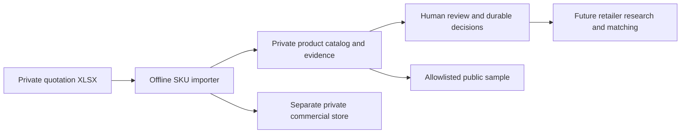

# Kinbor Retailer Intelligence

Connect specific Kinbor products with suitable U.S. retailers using traceable product data, source-backed retailer research, and human review.

**Current milestone: Phase 1 — Product & Business Foundation.** The offline product importer and its local data have been built and verified. This repository update publishes three project documents only; it does not publish the runtime source code, private catalog, original quotations, or a hosted application.

## Customer problem

The supplier provides products in quotation workbooks with different layouts, embedded images, and confidential commercial information. Each SKU requires at least one whole carton independently. Retailer research needs reliable SKU identities, carton quantities, specifications, and evidence before meaningful product recommendations can be made.

The business question is: **Which retailers are a good fit for which products, and what purchasing conditions still need to be checked?** Product fit and a buyer's willingness to purchase a whole carton remain separate questions.

## What Phase 1 delivers

- An offline importer that reads the actual workbook structures and all worksheets, including the hidden image-helper sheet.
- A normalized product catalog with source file, worksheet, one-based row, and field-level evidence.
- Embedded-image extraction, drawing/WPS cell-image links, OCR candidates, and attributable visual observations.
- Per-SKU whole-carton rules, durable human decisions, and review records for unresolved in-scope fields.
- Separate local catalog and commercial databases. Real procurement costs, inventory values, rebates, raw quotation rows, and source images remain private.
- A limited public-product projection and automated validation tests.

Real retailer discovery, TinyFish integration, matching, buyer outreach, and a web interface are later work. No Phase 2 TinyFish API calls have been made.

## Verified local results

Results below come from the completed local run, not from executing this documentation-only repository.

| Check | Measured result |
|---|---|
| Products | 210 unique SKU: 120 original-design + 90 Brunch Brother |
| Worksheets | 3 inspected; 2 product sheets and 1 hidden image-helper sheet |
| Image files | 212 extracted and reconciled to original file hashes |
| Image text review | 133 images with unverified OCR text; 79 with no text detected |
| Visual specification observations | 27 panels transcribed; 88 explicit source claims |
| Carton quantities | 210 usable quantities after two user-confirmed resolutions |
| Source inventory coverage | 189 numeric quantities + 21 availability/date notes, all private |
| Evidence | 1,579 records |
| Human review | 871 records: 658 pending, 3 resolved, 210 deferred as out of scope |
| Automated tests | 37 passed; 0 failures, errors, or skipped tests |
| Database checks | Integrity, foreign keys, and repeated-load checks passed |
| Real retailers / matches | 0 / 0; research and matching have not run |

The user confirmed 112 units per carton for `DTB6611-1` and `DTB6616-1`, and confirmed `HX588237` as the SKU. Original conflicting observations are retained. Sales-authorization review is outside the current scope at the user's request; the underlying authorization field remains unverified. Inventory is supplied by the source tables and is not recorded as missing.

## Simple architecture



The local implementation uses Python 3.11+, the standard library, and SQLite. It reads OOXML without executing workbook formulas or external links. Optional image-text extraction uses a local macOS Vision helper. Photographs, OCR candidates, source labels, and confirmed structured facts retain different statuses.

## How to read and run

Start with the [project specification](docs/PRD.md) for requirements, business rules, and acceptance criteria. Use the [data dictionary](docs/DATA_DICTIONARY.md) for field meanings and private/public boundaries.

This update contains documentation only. To execute Phase 1, use the separately delivered local source implementation, where the package currently lives under `src/kinbor_intel/`. From that source directory:

```bash
# Python 3.11+; no third-party runtime dependencies are required.
PYTHONPATH=src python3 -m unittest discover -s tests -v
PYTHONPATH=src python3 -m kinbor_intel import-skus \
  '/path/to/original-design-quotation.xlsx' \
  '/path/to/brunch-brother-quotation.xlsx' \
  --private-dir ../private-local

# Optional: join existing private OCR and visual-observation sidecars.
PYTHONPATH=src python3 -m kinbor_intel enrich-images ../private-local
PYTHONPATH=src python3 -m kinbor_intel apply-decisions ../private-local
PYTHONPATH=src python3 -m kinbor_intel validate ../private-local
PYTHONPATH=src python3 -m kinbor_intel load-db ../private-local \
  --db ../private-local/catalog.sqlite
```

Private output must remain outside the public source directory. Existing `human_decisions.json` is replayed on re-import and after image enrichment, preserving reviewed values and scope instructions. Original source workbook bytes are retained unchanged.

## Repository direction

The intended project organization is shown below. This documentation update includes only `README.md`, `docs/PRD.md`, and `docs/DATA_DICTIONARY.md`. Other paths describe the planned organization; empty directories and future functionality are not implementation evidence.

```text
kinbor-retailer-intelligence/
├── README.md
├── docs/
│   ├── PRD.md
│   └── DATA_DICTIONARY.md
├── src/
│   ├── product_catalog/
│   ├── retailer_discovery/
│   ├── tinyfish_integration/
│   ├── evidence_validation/
│   ├── product_matching/
│   └── human_review/
├── app/
├── data/
│   ├── sample_products.json
│   └── sample_retailers.json
├── tests/
├── demo/
│   ├── screenshots/
│   └── example_outputs/
├── .env.example
├── .gitignore
└── requirements.txt
```

Moving the existing local implementation into this module layout is future repository work. A retailer sample, when added, must be clearly identified as synthetic or supported by actual research. No real retailer observations have been created in Phase 1.

## Next milestone

Integrate authorized live retailer research, retain field-level webpage evidence, and validate product-fit hypotheses with human review and buyer feedback. Evaluate research quality and whole-carton feasibility using measured results. Phase 1 provides the product foundation for this work.
