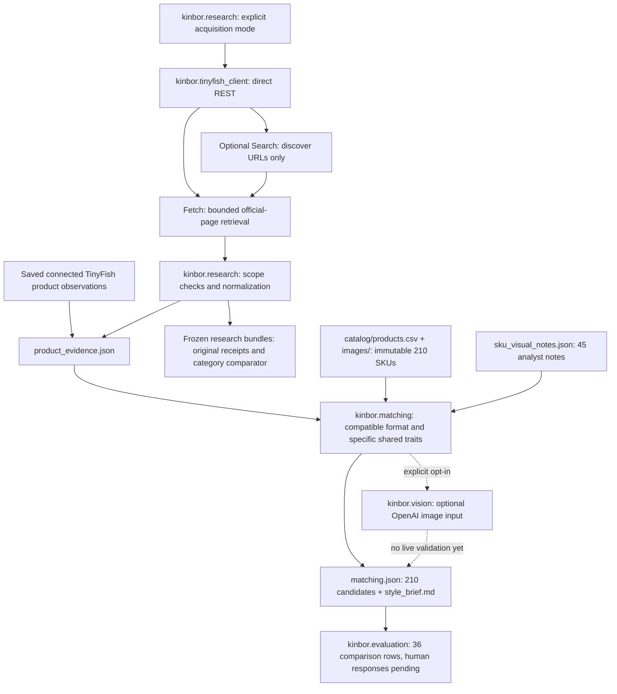

# Architecture and engineering decisions

The product boundary is a source-linked research brief for a human, not automatic buyer selection. The preserved catalog supplies SKU/image/source/carton facts; retailer pages supply timestamped observations; matching supplies explicitly labelled hypotheses.

## Module responsibilities

| Module | Responsibility and boundary |
|---|---|
| `kinbor/research.py` | Official-domain discovery, page normalization, source evidence, catalog joins, output writing and offline validation. `--product-evidence` adds product-first acquisition and current style outputs. |
| `kinbor/tinyfish_client.py` | Fixed official API origins, environment credentials, bounded retries/budgets, request receipts and explicit failures. Search/Agent helpers are separate capabilities; Agent is not an automatic fallback. |
| `kinbor/matching.py` | Small inspectable vocabulary and functional compatibility rules. Retains every SKU, supporting evidence, counterevidence and uncertainty; never fills a category quota. |
| `kinbor/vision.py` | Optional bounded image transmission and model inference; disabled by default. |
| `kinbor/pipeline.py` | Validates the combined historical tables and displays current style pointers. Existing `current_pilot` CSV labels belong to the earlier category run. |
| `kinbor/evaluation.py` | Deterministic comparison sampling, separate A/B key, response-preserving generation and summaries of actual responses only. |
| `catalog/import.py` | Frozen local importer. Exports allowlisted catalog fields and sanitized product images; private sources are not required for the public demo. |

## Research and evidence contracts

Search snippets can nominate a URL. Only fetched official page content can support a retailer observation. An external shop requires observed linkage from the official site; an explicit product URL alone cannot authorize it. URLs, observation times, quotes, acquisition provenance and missing values remain visible.

The direct client limits pages, attempts and scheduling time, honors bounded throttling/backoff, refuses credential-forwarding redirects and blocks before transport when credentials are absent. Partial URL failures remain partial; HTTP 200 does not prove a complete run. Usage counts do not establish billed cost. The [API notes](TINYFISH_API.md) document the existing implementation and historical provider references.

The current 19-product capture came from connected TinyFish Search/Fetch tools. The adjacent `api_receipt.json` files authenticate older Python REST runs, not that newer capture. New REST product acquisition is covered by mocks; current cleanup checks make no fresh live calls.

## Matching and abstention

An eligible style hypothesis needs an individually inspected catalog image, a specific product observation, a compatible functional family and sufficiently specific overlapping traits. Retailer tags are inferred from observed text, not image pixels. Generic plain covers alone are insufficient; a refill needs compatibility evidence to stand in for a notebook. There is no retailer-diversity rule. SKU order stabilizes display ties only.

The default preview cap is four, not a minimum. Atlas displays one hypothesis; Shorthand displays four of eight supported review hypotheses; Wonder Fair displays none. All three retain 210 candidate records. The 165 catalog images without notes cannot support a style judgement in this baseline. This deliberately small vocabulary and sample can miss good matches; abstention is uncertainty, not evidence that a store dislikes the catalog.

## Optional image assessment

`kinbor/vision.py` implements image input through the fixed OpenAI Responses endpoint. It requires explicit permission for these specific images, `--vision --authorize-openai-images`, `OPENAI_API_KEY` and an image-capable `KINBOR_VISION_MODEL`. At most eight already-supported, hash-checked catalog WebPs and three public retailer image URLs are sent in one request with `store: false`. Private supplier documents and arbitrary uploads are excluded. Permission to transmit is distinct from publication rights.

No live model assessment is saved: all three receipts contain zero requests and no assessments. Missing permission, credentials, model or images, refusal and invalid results keep the offline baseline and `MULTIMODAL LIVE NOT VALIDATED`. Model output would still be inference pending human review; access, model availability and quality need an enabled pilot.

## Evaluation and preservation

Automated tests exercise joins, deterministic outputs and failure boundaries. They do not establish recommendation quality, private workbook reconciliation, image rights, current inventory or commercial outcomes. The 36-row partial-blind review is pending, and the changed discovery evidence confounds any attempt to attribute future preference differences solely to the matcher. See the [evaluation protocol](MATCHING_EVALUATION.md).

The original 214 Phase 1 hashes and protected file bytes are preserved. Catalog assets live in `catalog/`; application code lives in `kinbor/`; store bundles, frozen combined tables, reviews and historical reports live in `examples/`. The original manifest remains unchanged, while `kinbor/paths.py` resolves its legacy paths. Raw JSON/CSV evidence retains its original values; application resolution handles historical `live/` references, and Markdown links follow the new layout. The [read-only verifier](../scripts/verify_repository.py) checks saved evidence and preservation without regenerating it. [Baseline guide](BASELINES.md) explains the coexistence of old and new artifacts.
