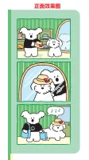
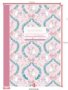
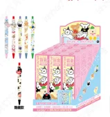
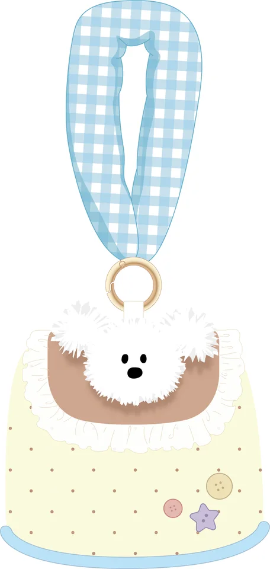

# Retailer research brief

Website: https://www.atlasstationers.com/
Acquisition: `tinyfish_api_fetch`. Status: **completed**. Actual run ID: None (page fetch has no browser-run ID).

This is a research preview. No outreach, forms or purchases occurred.
All **210** catalog SKUs were evaluated; **118** have observed category overlap. The following evidence-based representative preview needs human image review. Display order is not a buyer-intent or aesthetic ranking.

| Dimension | Observation |
|---|---|
| Product Fit | Category overlap; human review required |
| Evidence Strength | Official page observations; not independent verification |
| Buyer Access | General contact only |
| Order Feasibility | Unknown |

Direct API receipt: [api_receipt.json](api_receipt.json). Authenticated response received: **True**. Fetch is synchronous; there is no browser run ID. Provider request IDs, bounded request counts and available usage are in the receipt; unreported billed cost is Unknown.

| SKU | Inferred category | Minimum per SKU | Evidence |
|---|---|---|---|
| DTBB0079 | Planners & Calendars | 1 carton / 120 units | [E027|E036|E045|E007|E016|E022](https://www.atlasstationers.com/collections/hightide-planners) |
| DT54750 | Notebooks & Journals | 1 carton / 60 units | [E001|E044|E031|E039|E015|E021](https://www.atlasstationers.com/) |
| DT589003 | Pens & Writing | 1 carton / 768 units | [E002|E020|E030|E038|E047|E014](https://www.atlasstationers.com/) |
| DTBB0113 | Pouches & Cases | 1 carton / 120 units | [E010|E034|E042|E050|E019|E025](https://www.atlasstationers.com/) |

### DTBB0079 — 周计划-亲故最棒

Observed Planners & Calendars through category-specific page text. No product-specific preference established. Review preview rotates observed categories and equally supported collections. SKU alphabetical order breaks display ties only; all candidates require human image and commercial review.
Source: `Brunch Brother新品`, row 92. Aesthetic fit: **Needs human image review**. MOQ: one full carton, 120 units. Order feasibility: **Unknown**.

### DT54750 — B5横线本-粉雾猫语

Observed Notebooks & Journals through page text. Literal shared attributes: lined. Review preview rotates observed categories and equally supported collections. SKU alphabetical order breaks display ties only; all candidates require human image and commercial review.
Source: `原创-在售产品`, row 64. Aesthetic fit: **Needs human image review**. MOQ: one full carton, 60 units. Order feasibility: **Unknown**.

### DT589003 — 盲盒中性笔-BB甜心派对

Observed Pens & Writing through page text. No product-specific preference established. Review preview rotates observed categories and equally supported collections. SKU alphabetical order breaks display ties only; all candidates require human image and commercial review.
Source: `Brunch Brother新品`, row 49. Aesthetic fit: **Needs human image review**. MOQ: one full carton, 768 units. Order feasibility: **Unknown**.

### DTBB0113 — BB peper手提收纳包

Observed Pouches & Cases through navigation only. No product-specific preference established. Review preview rotates observed categories and equally supported collections. SKU alphabetical order breaks display ties only; all candidates require human image and commercial review.
Source: `Brunch Brother新品`, row 76. Aesthetic fit: **Needs human image review**. MOQ: one full carton, 120 units. Order feasibility: **Unknown**.

## Evidence and unknowns

See `evidence.csv` for exact quotes, field-level source URLs, retrieval timestamps and confidence. `research.json` retains the captured page excerpts used to check those quotes. Unknown means not established within this bounded capture, not absent from the website.

Human review must check the actual image, paper, language/layout, styling, dimensions, resale authority, supplier availability, costs and buyer acceptance of one carton per individual SKU. A general contact page is not permission for a vendor pitch. Read every submission condition on the source page before any action. No automatic aesthetic or buying-intent conclusion is made.
