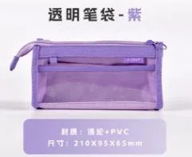

# Store-specific SKU review

Official site: https://www.atlasstationers.com/

**MULTIMODAL LIVE NOT VALIDATED**. All selections need human review. No model quality improvement has been established.

Confirmed product facts are the immutable SKU/image/source/carton joins. Style comparison is inference. Current inventory, supplier availability, Kinbor retail/landed price, paper performance, material, resale authorization, buyer interest and one-carton acceptance are Unknown.

Audited 210 SKUs; 1 have a specific text/style hypothesis. Preview has 1 candidates; this is a maximum, not a quota.

## Why these candidates

### DT55566 — 透明笔袋-紫

**One full carton per SKU: 100 units. Human review: pending.**

**Visible SKU features (analyst inference):** Purple translucent rectangular zipped pen pouch; structure and dimensions need review.

**Why investigate:** Style hypothesis from local SKU image observation and specific official product text: transparent; reference Hightide General Purpose Case - A6. Retailer image pixels and buying preference remain unvalidated.

- [atlas-P06 — Hightide General Purpose Case - A6](https://www.atlasstationers.com/collections/pen-storage/products/hightide-general-purpose-case-a6): A6 gusseted PVC case with transparent front. Shared design terms (inference): transparent.

**Why it might fail:** Minimum is 100 units for this individual SKU; buyer carton acceptance Unknown. Shared cover traits do not establish identical motif, language, ruling, binding, material or paper performance; compare images and physical samples. Other sampled designs (atlas-P01, atlas-P02, atlas-P03) provide different references; absence of overlap is not evidence of dislike.

**Verify next:** Compare the linked retailer image with this actual SKU; inspect language/layout, physical sample, paper and authorized resale; ask a human buyer to assess the carton quantity.

## Retailer product evidence

Images are URL references only; image rights remain with the owner. Retailer pixels were not visually assessed. Observed listings do not establish current stock.

| Evidence | Official product | Public price | Image reference | Observed UTC |
|---|---|---|---|---|
| atlas-P01 | [Midori MD Notebook - Ruled - A5](https://www.atlasstationers.com/collections/notebooks/products/midori-md-notebook-ruled-a5) | 14.40 USD | [source image](https://www.atlasstationers.com/cdn/shop/files/MIDORI_A5_RULED_A.jpg?crop=center&height=1200&v=1751028642&width=1200) | 2026-11-10T04:01:11Z |
| atlas-P02 | [Leuchtturm A5 Hardcover Notebook - Dot Grid](https://www.atlasstationers.com/collections/notebooks/products/leuchtturm-a5-hardcover-notebook-dot-grid) | 25.95 USD | [source image](https://www.atlasstationers.com/cdn/shop/files/LEUCHTTURM1917_A5HARDCOVER_GROUP_DOTTED_23133cbf-e764-4c33-972e-f6d4359d57bf.jpg?crop=center&height=1200&v=1751028160&width=1200) | 2026-11-10T04:01:11Z |
| atlas-P03 | [Rhodia Rhodiarama Soft Cover A5 Notebook - Dot Grid](https://www.atlasstationers.com/collections/notebooks/products/rhodia-rhodiarama-soft-cover-a5-notebook-dot-grid) | 30.60 USD | [source image](https://www.atlasstationers.com/cdn/shop/products/RHODIARAMA_SOFTCOVER_POPPY_ca9fb750-d9e2-4898-8563-80ddc3be21cd.jpg?crop=center&height=1200&v=1751028178&width=1200) | 2026-11-10T04:01:11Z |
| atlas-P04 | [Kokuyo Campus Soft Ring Notebook - B5](https://www.atlasstationers.com/collections/notebooks/products/kokuyo-campus-soft-ring-notebook-b5) | 5.20 USD | [source image](https://www.atlasstationers.com/cdn/shop/files/CAMPUS_SOFT_RING_NOTEBOOK_LIGHT_BLUE_A.jpg?crop=center&height=1200&v=1751027670&width=1200) | 2026-11-10T04:01:11Z |
| atlas-P05 | [Field Notes Chicago Edition 3-Pack, 3 1/2" x 5 1/2"](https://www.atlasstationers.com/collections/notebooks/products/field-notes-chicago-edition-3-pack-3-1-2-x-5-1-2) | 14.95 USD | [source image](https://www.atlasstationers.com/cdn/shop/files/FN-28-Chicago-new-A.jpg?crop=center&height=1200&v=1751028907&width=1200) | 2026-11-10T04:01:11Z |
| atlas-P06 | [Hightide General Purpose Case - A6](https://www.atlasstationers.com/collections/pen-storage/products/hightide-general-purpose-case-a6) | 10.00 USD | [source image](https://www.atlasstationers.com/cdn/shop/files/mask-case_1_nahe-general-purpose-case-A6.jpg?crop=center&height=1200&v=1688393709&width=1200) | 2026-11-10T04:01:11Z |
| atlas-P07 | [Lamy Safari Fountain Pen - Matte Charcoal](https://www.atlasstationers.com/collections/fountain-pens/products/lamy-safari-fountain-pen-matte-charcoal) | 29.60 USD | [source image](https://www.atlasstationers.com/cdn/shop/files/LAMYSAFARIFPCHARCOAL.jpg?crop=center&height=1200&v=1776801254&width=1200) | 2026-11-10T04:01:11Z |

## Before/after review

Saved category baseline: DTBB0079, DT54750, DT589003, DTBB0113.
The old baseline is retained in the adjacent original research/CSV files for comparison. Current style decisions and all 210 candidate reasons are in `matching.json`. No accuracy or improvement percentage is available without independent labels.
Use [the evaluation protocol](../../../docs/MATCHING_EVALUATION.md) and [review worksheet](../../evaluation/reviews.csv); intentional counterexamples are hypotheses, not gold negatives.
