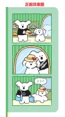
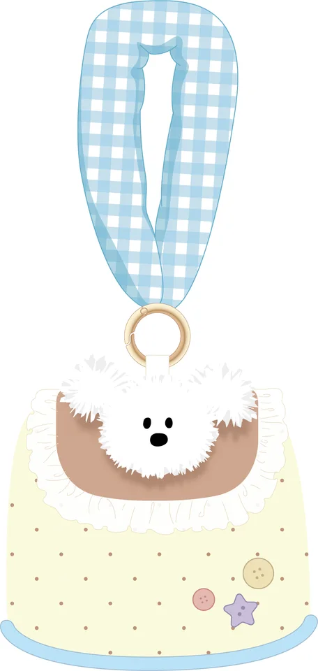
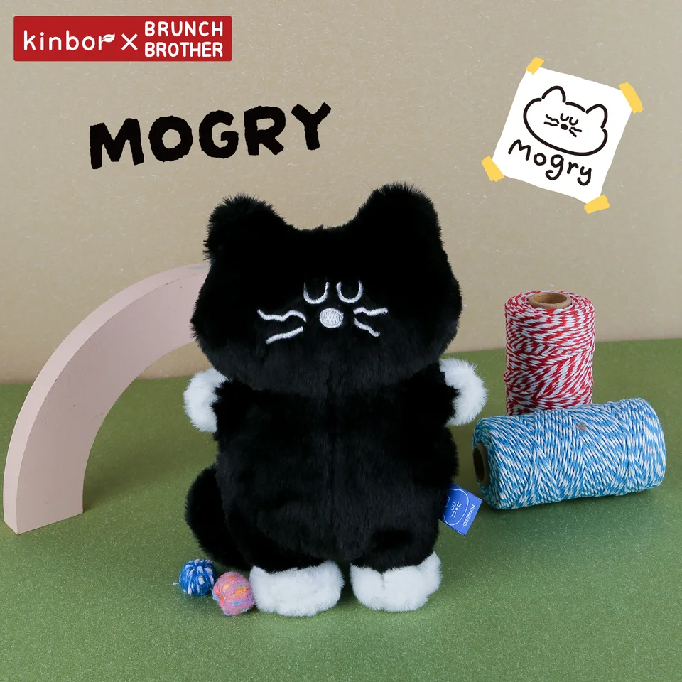
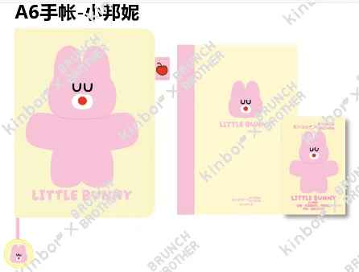

# Retailer research brief

Website: https://shopshorthand.com/
Acquisition: `tinyfish_api_fetch`. Status: **completed**. Actual run ID: None (page fetch has no browser-run ID).

This is a research preview. No outreach, forms or purchases occurred.
All **210** catalog SKUs were evaluated; **126** have observed category overlap. The following evidence-based representative preview needs human image review. Display order is not a buyer-intent or aesthetic ranking.

| Dimension | Observation |
|---|---|
| Product Fit | Category overlap; human review required |
| Evidence Strength | Official page observations; not independent verification |
| Buyer Access | Submission-related policy; applicability requires human review |
| Order Feasibility | Unknown |

Direct API receipt: [api_receipt.json](api_receipt.json). Authenticated response received: **True**. Fetch is synchronous; there is no browser run ID. Provider request IDs, bounded request counts and available usage are in the receipt; unreported billed cost is Unknown.

| SKU | Inferred category | Minimum per SKU | Evidence |
|---|---|---|---|
| DTBB0079 | Planners & Calendars | 1 carton / 120 units | [E039|E049|E002|E029|E017|E024](https://shopshorthand.com/collections/daily-planner-category) |
| DTBB0113 | Pouches & Cases | 1 carton / 120 units | [E030|E040|E050|E005|E011|E018](https://shopshorthand.com/collections/bags-cases-pouches) |
| DTBB0042 | Desk & Office Tools | 1 carton / 100 units | [E033|E043|E053|E006|E012|E019](https://shopshorthand.com/collections/bags-cases-pouches) |
| DTBB0021 | Notebooks & Journals | 1 carton / 40 units | [E001|E028|E038|E048|E015|E022](https://shopshorthand.com/) |

### DTBB0079 — 周计划-亲故最棒

Observed Planners & Calendars through category-specific page text. No product-specific preference established. Review preview rotates observed categories and equally supported collections. SKU alphabetical order breaks display ties only; all candidates require human image and commercial review.
Source: `Brunch Brother新品`, row 92. Aesthetic fit: **Needs human image review**. MOQ: one full carton, 120 units. Order feasibility: **Unknown**.

### DTBB0113 — BB peper手提收纳包

Observed Pouches & Cases through category-specific page text. No product-specific preference established. Review preview rotates observed categories and equally supported collections. SKU alphabetical order breaks display ties only; all candidates require human image and commercial review.
Source: `Brunch Brother新品`, row 76. Aesthetic fit: **Needs human image review**. MOQ: one full carton, 120 units. Order feasibility: **Unknown**.

### DTBB0042 — Mogry造型手腕垫（黑色）

Observed Desk & Office Tools through page text. No product-specific preference established. Review preview rotates observed categories and equally supported collections. SKU alphabetical order breaks display ties only; all candidates require human image and commercial review.
Source: `Brunch Brother新品`, row 10. Aesthetic fit: **Needs human image review**. MOQ: one full carton, 100 units. Order feasibility: **Unknown**.

### DTBB0021 — A6手帐-小邦妮

Observed Notebooks & Journals through page text. No product-specific preference established. Review preview rotates observed categories and equally supported collections. SKU alphabetical order breaks display ties only; all candidates require human image and commercial review.
Source: `Brunch Brother新品`, row 26. Aesthetic fit: **Needs human image review**. MOQ: one full carton, 40 units. Order feasibility: **Unknown**.

## Submission policy excerpts

Read the full source before any action; these captured excerpts do not establish acceptance of Kinbor or any product.

> We are always on the hunt for new products - please keep in mind that we are a small store with a very specific aesthetic and product offering. Please send us an email with more information about your products.
Source: [E026](https://shopshorthand.com/pages/faqs). Retrieved 2026-11-10T03:18:21Z. Confidence: medium.

> Our buyer is not always in the store so we discourage bringing products to the store. Please send us an email with more information about your products.
Source: [E027](https://shopshorthand.com/pages/faqs). Retrieved 2026-11-10T03:18:21Z. Confidence: medium.

## Evidence and unknowns

See `evidence.csv` for exact quotes, field-level source URLs, retrieval timestamps and confidence. `research.json` retains the captured page excerpts used to check those quotes. Unknown means not established within this bounded capture, not absent from the website.

Human review must check the actual image, paper, language/layout, styling, dimensions, resale authority, supplier availability, costs and buyer acceptance of one carton per individual SKU. A general contact page is not permission for a vendor pitch. Read every submission condition on the source page before any action. No automatic aesthetic or buying-intent conclusion is made.
