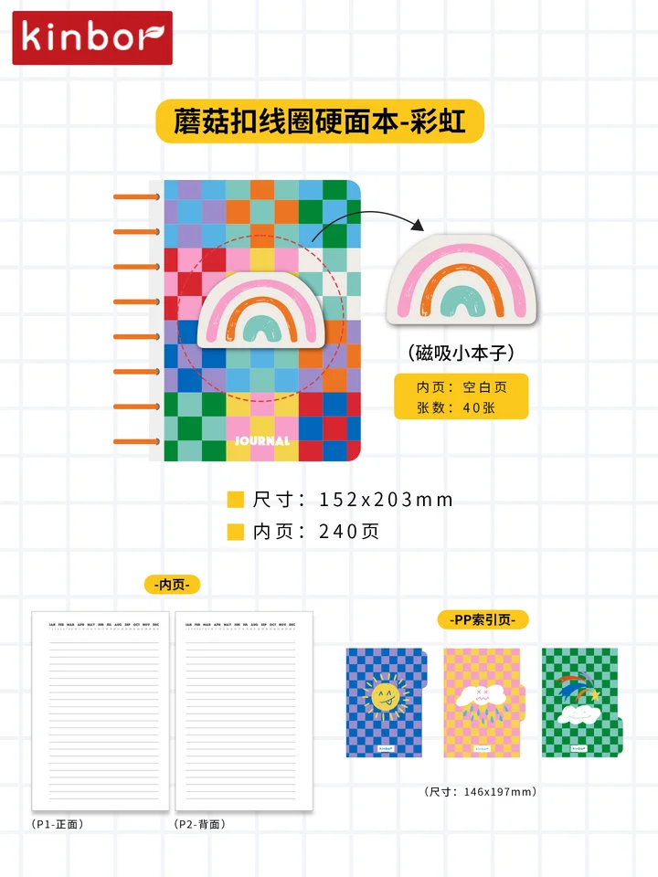
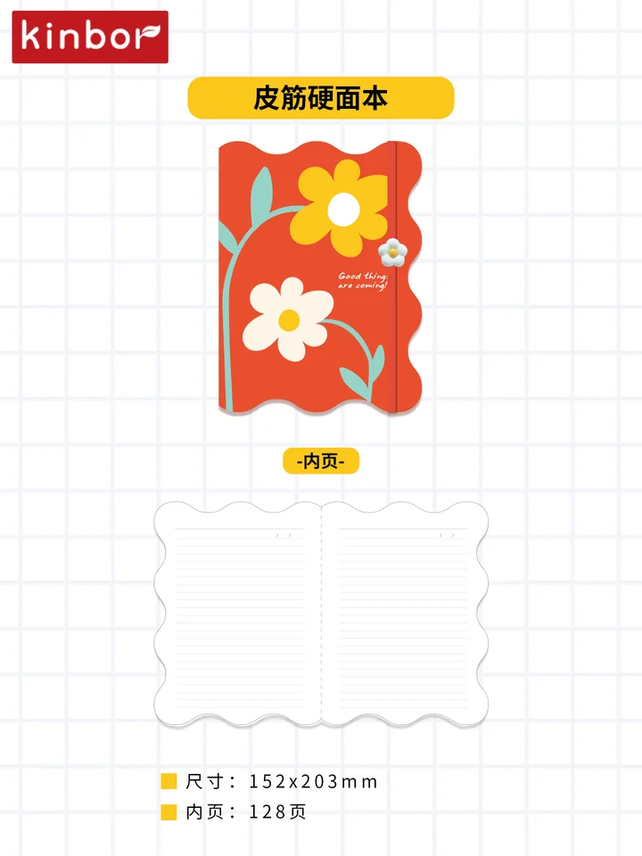
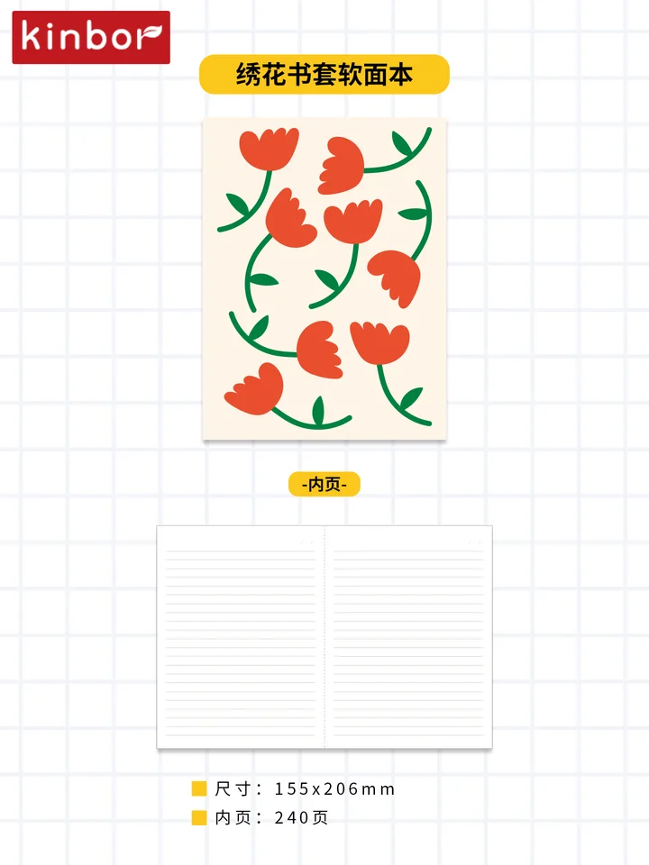
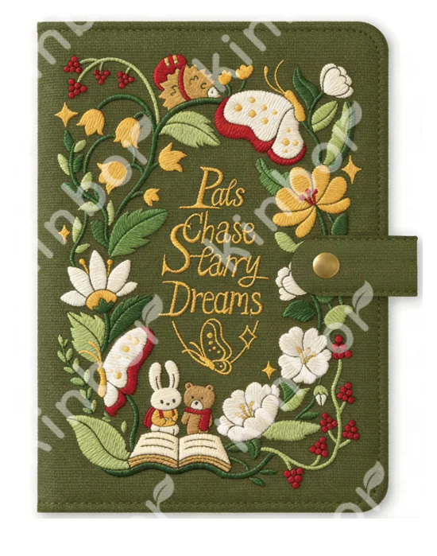

# Store-specific SKU review

Official site: https://shopshorthand.com/

**MULTIMODAL LIVE NOT VALIDATED**. All selections need human review. No model quality improvement has been established.

Confirmed product facts are the immutable SKU/image/source/carton joins. Style comparison is inference. Current inventory, supplier availability, Kinbor retail/landed price, paper performance, material, resale authorization, buyer interest and one-carton acceptance are Unknown.

Audited 210 SKUs; 8 have a specific text/style hypothesis. Preview has 4 candidates; this is a maximum, not a quota.

## Why these candidates

### DT54744 — 蘑菇扣线圈硬面本-彩虹

**One full carton per SKU: 24 units. Human review: pending.**

**Visible SKU features (analyst inference):** Multicolor checker cover and rainbow motif; ring binding and lined-page diagram visible.

**Why investigate:** Style hypothesis from local SKU image observation and specific official product text: checker, geometric; reference Reporter Notebook - Checker Black. Retailer image pixels and buying preference remain unvalidated.

- [shorthand-P03 — Reporter Notebook - Checker Black](https://shopshorthand.com/collections/notepad/products/reporter-notebook-checker-black): Black checker pattern; compact reporter format; gold foil title/date; gold wire-o; lined pages. Shared design terms (inference): checker, geometric.

**Why it might fail:** SKU image suggests lined pages; physical ruling and layout equivalence remain unverified. Reference is named Checker Black; this SKU uses multicolor checks and a rainbow motif. Shared geometry does not establish palette fit. Reference includes handedness, printing or binding details not established for Kinbor; motif overlap does not establish equivalent construction. Shared cover traits do not establish identical motif, language, ruling, binding, material or paper performance; compare images and physical samples. Other sampled designs (shorthand-P01, shorthand-P02, shorthand-P04) provide different references; absence of overlap is not evidence of dislike.

**Verify next:** Compare the linked retailer image with this actual SKU; inspect language/layout, physical sample, paper and authorized resale; ask a human buyer to assess the carton quantity.

### DT54726 — 皮筋硬面本

**One full carton per SKU: 24 units. Human review: pending.**

**Visible SKU features (analyst inference):** Large white/yellow flowers on red-orange cover; elastic closure visible.

**Why investigate:** Style hypothesis from local SKU image observation and specific official product text: botanical; reference Lefty Standard Notebook - Botanical Archway. Retailer image pixels and buying preference remain unvalidated.

- [shorthand-P02 — Lefty Standard Notebook - Botanical Archway](https://shopshorthand.com/collections/notebooks/products/lefty-standard-notebook-botanical-archway): Botanical Archway design title; left-handed notebook; gold foil lines; brass wire-o; lined interior. Shared design terms (inference): botanical.

**Why it might fail:** Retailer reference specifies ruling; Kinbor ruling/layout is not established by this image comparison. Botanical Archway is a named design; its title alone does not establish identical flower drawing, palette or artwork provenance. Reference includes handedness, printing or binding details not established for Kinbor; motif overlap does not establish equivalent construction. Shared cover traits do not establish identical motif, language, ruling, binding, material or paper performance; compare images and physical samples. Other sampled designs (shorthand-P01, shorthand-P03, shorthand-P04) provide different references; absence of overlap is not evidence of dislike.

**Verify next:** Compare the linked retailer image with this actual SKU; inspect language/layout, physical sample, paper and authorized resale; ask a human buyer to assess the carton quantity.

### DT54729 — 绣花书套软面本

**One full carton per SKU: 24 units. Human review: pending.**

**Visible SKU features (analyst inference):** Red tulip motifs on cream cover; lined page diagram visible.

**Why investigate:** Style hypothesis from local SKU image observation and specific official product text: botanical; reference Lefty Standard Notebook - Botanical Archway. Retailer image pixels and buying preference remain unvalidated.

- [shorthand-P02 — Lefty Standard Notebook - Botanical Archway](https://shopshorthand.com/collections/notebooks/products/lefty-standard-notebook-botanical-archway): Botanical Archway design title; left-handed notebook; gold foil lines; brass wire-o; lined interior. Shared design terms (inference): botanical.

**Why it might fail:** SKU image suggests lined pages; physical ruling and layout equivalence remain unverified. Botanical Archway is a named design; its title alone does not establish identical flower drawing, palette or artwork provenance. Reference includes handedness, printing or binding details not established for Kinbor; motif overlap does not establish equivalent construction. Shared cover traits do not establish identical motif, language, ruling, binding, material or paper performance; compare images and physical samples. Other sampled designs (shorthand-P01, shorthand-P03, shorthand-P04) provide different references; absence of overlap is not evidence of dislike.

**Verify next:** Compare the linked retailer image with this actual SKU; inspect language/layout, physical sample, paper and authorized resale; ask a human buyer to assess the carton quantity.

### DTYC0006 — A6手帐-秘境

**One full carton per SKU: 40 units. Human review: pending.**

**Visible SKU features (analyst inference):** Flowers, mushrooms and book illustration around gold-colored lettering on olive cover.

**Why investigate:** Style hypothesis from local SKU image observation and specific official product text: botanical; reference Lefty Standard Notebook - Botanical Archway. Retailer image pixels and buying preference remain unvalidated.

- [shorthand-P02 — Lefty Standard Notebook - Botanical Archway](https://shopshorthand.com/collections/notebooks/products/lefty-standard-notebook-botanical-archway): Botanical Archway design title; left-handed notebook; gold foil lines; brass wire-o; lined interior. Shared design terms (inference): botanical.

**Why it might fail:** Retailer reference specifies ruling; Kinbor ruling/layout is not established by this image comparison. Botanical Archway is a named design; its title alone does not establish identical flower drawing, palette or artwork provenance. Reference includes handedness, printing or binding details not established for Kinbor; motif overlap does not establish equivalent construction. Shared cover traits do not establish identical motif, language, ruling, binding, material or paper performance; compare images and physical samples. Other sampled designs (shorthand-P01, shorthand-P03, shorthand-P04) provide different references; absence of overlap is not evidence of dislike.

**Verify next:** Compare the linked retailer image with this actual SKU; inspect language/layout, physical sample, paper and authorized resale; ask a human buyer to assess the carton quantity.

## Retailer product evidence

Images are URL references only; image rights remain with the owner. Retailer pixels were not visually assessed. Observed listings do not establish current stock.

| Evidence | Official product | Public price | Image reference | Observed UTC |
|---|---|---|---|---|
| shorthand-P01 | [Task Pad Notebook - Ocean](https://shopshorthand.com/products/task-pad-notebook-ocean) | 22.00 Unknown | [source image](https://shopshorthand.com/cdn/shop/files/taskpad_NBTPO-41_ocean_white_web.jpg?v=1794260951) | 2026-11-10T04:01:11Z |
| shorthand-P02 | [Lefty Standard Notebook - Botanical Archway](https://shopshorthand.com/collections/notebooks/products/lefty-standard-notebook-botanical-archway) | 26.00 Unknown | [source image](https://shopshorthand.com/cdn/shop/files/notebook_NB58-LINED-L_botanicalarchway_white_leftybutton_25mp.jpg?v=1780181290) | 2026-11-10T04:01:11Z |
| shorthand-P03 | [Reporter Notebook - Checker Black](https://shopshorthand.com/collections/notepad/products/reporter-notebook-checker-black) | 12.00 Unknown | [source image](https://shopshorthand.com/cdn/shop/files/reporter_NBRECB-49_checkerblack_white_web.jpg?v=1793994146) | 2026-11-10T04:01:11Z |
| shorthand-P04 | [Calendar Notepad](https://shopshorthand.com/collections/notepad/products/calendar-notepad) | 18.00 Unknown | [source image](https://shopshorthand.com/cdn/shop/files/notepad_NPC-04_calendarnotepad_whitebg.jpg?v=1752799145) | 2026-11-10T04:01:11Z |
| shorthand-P05 | [Mareku Box Pen Case - Dark Blue](https://shopshorthand.com/collections/bags-cases-pouches/products/mareku-box-pen-case-dark-blue) | 15.00 USD | [source image](https://shopshorthand.com/cdn/shop/files/a57fbf06162f5815d708275c853355ed5f035b1150031642-vrg2jgmw-51134978_large_099f1039-f30d-4280-a3e8-b6c4f077d409.jpg?v=1727894959) | 2026-11-10T04:01:11Z |
| shorthand-P06 | [Pale Green Adhesive Notes (Pack of 3) - Craft Design Technology](https://shopshorthand.com/collections/notepad/products/pale-green-adhesive-notes-pack-of-3-craft-design-technology) | 6.00 Unknown | [source image](https://shopshorthand.com/cdn/shop/products/E3_82_A2_E3_82_A4_E3_83_86_E3_83_A047_01.png?v=1593117611) | 2026-11-10T04:01:11Z |

## Before/after review

Saved category baseline: DTBB0079, DTBB0113, DTBB0042, DTBB0021.
The old baseline is retained in the adjacent original research/CSV files for comparison. Current style decisions and all 210 candidate reasons are in `matching.json`. No accuracy or improvement percentage is available without independent labels.
Use [the evaluation protocol](../../../docs/MATCHING_EVALUATION.md) and [review worksheet](../../evaluation/reviews.csv); intentional counterexamples are hypotheses, not gold negatives.
