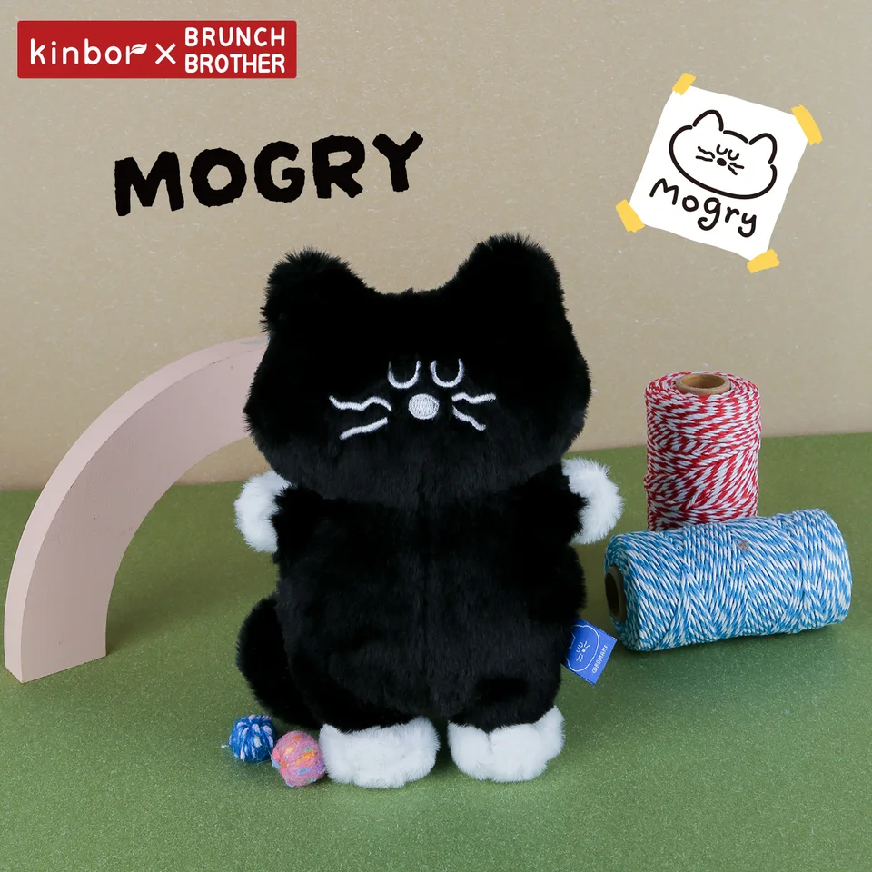
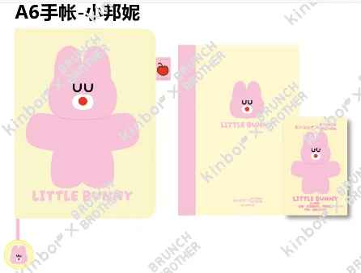
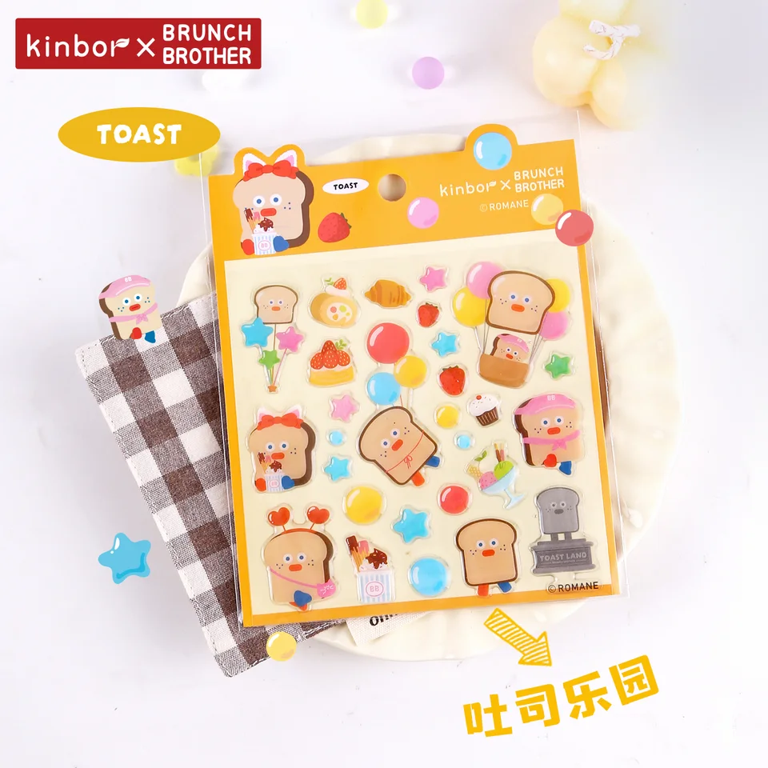
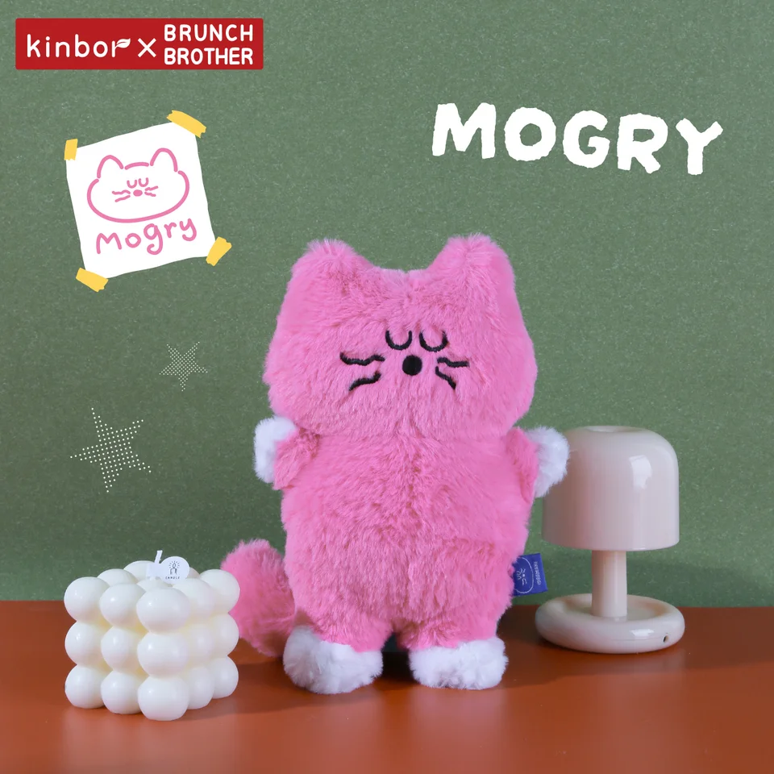

# Retailer research brief

Website: https://www.wonderfair.com/
Acquisition: `tinyfish_api_fetch`. Status: **completed**. Actual run ID: None (page fetch has no browser-run ID).

This is a research preview. No outreach, forms or purchases occurred.
All **210** catalog SKUs were evaluated; **87** have observed category overlap. The following evidence-based representative preview needs human image review. Display order is not a buyer-intent or aesthetic ranking.

| Dimension | Observation |
|---|---|
| Product Fit | Category overlap; human review required |
| Evidence Strength | Official page observations; not independent verification |
| Buyer Access | Submission-related policy; applicability requires human review |
| Order Feasibility | Unknown |

Direct API receipt: [api_receipt.json](api_receipt.json). Authenticated response received: **True**. Fetch is synchronous; there is no browser run ID. Provider request IDs, bounded request counts and available usage are in the receipt; unreported billed cost is Unknown.

| SKU | Inferred category | Minimum per SKU | Evidence |
|---|---|---|---|
| DTBB0042 | Desk & Office Tools | 1 carton / 100 units | [E002](https://www.wonderfair.com/contact) |
| DTBB0021 | Notebooks & Journals | 1 carton / 40 units | [E004](https://www.wonderfair.com/submit) |
| DTBB0035 | Stickers & Decorative Tape | 1 carton / 500 units | [E005](https://www.wonderfair.com/submit) |
| DTBB0043 | Desk & Office Tools | 1 carton / 100 units | [E002](https://www.wonderfair.com/contact) |

### DTBB0042 — Mogry造型手腕垫（黑色）

Observed Desk & Office Tools through page text. No product-specific preference established. Review preview rotates observed categories and equally supported collections. SKU alphabetical order breaks display ties only; all candidates require human image and commercial review.
Source: `Brunch Brother新品`, row 10. Aesthetic fit: **Needs human image review**. MOQ: one full carton, 100 units. Order feasibility: **Unknown**.

### DTBB0021 — A6手帐-小邦妮

Observed Notebooks & Journals through page text. No product-specific preference established. Review preview rotates observed categories and equally supported collections. SKU alphabetical order breaks display ties only; all candidates require human image and commercial review.
Source: `Brunch Brother新品`, row 26. Aesthetic fit: **Needs human image review**. MOQ: one full carton, 40 units. Order feasibility: **Unknown**.

### DTBB0035 — 滴胶贴纸-吐司乐园

Observed Stickers & Decorative Tape through page text. No product-specific preference established. Review preview rotates observed categories and equally supported collections. SKU alphabetical order breaks display ties only; all candidates require human image and commercial review.
Source: `Brunch Brother新品`, row 22. Aesthetic fit: **Needs human image review**. MOQ: one full carton, 500 units. Order feasibility: **Unknown**.

### DTBB0043 — Mogry造型手腕垫（粉色）

Observed Desk & Office Tools through page text. No product-specific preference established. Review preview rotates observed categories and equally supported collections. SKU alphabetical order breaks display ties only; all candidates require human image and commercial review.
Source: `Brunch Brother新品`, row 11. Aesthetic fit: **Needs human image review**. MOQ: one full carton, 100 units. Order feasibility: **Unknown**.

## Submission policy excerpts

Read the full source before any action; these captured excerpts do not establish acceptance of Kinbor or any product.

> If your work aligns with our frequent stocking interests above, please send an email of introduction to submissions@wonderfair.com with appropriate links to view your catalog of goods. If your work is on the Faire platform, please feel free to send us your affiliate direct link.
Source: [E007](https://www.wonderfair.com/submit). Retrieved 2026-11-10T03:19:58Z. Confidence: medium.

> As we are able, we will respond by email if we feel your work is a good fit for Wonder Fair at the present time. Although we appreciate the time it takes for artists to put their work out into the universe, unfortunately we cannot respond to each inquiry, and our response time will be heavily dependent on our seasonal shop needs and our staff’s available free time. Please refrain from contacting the shop with follow up inquiries, as individual staff are unable to provide updates.
Source: [E008](https://www.wonderfair.com/submit). Retrieved 2026-11-10T03:19:58Z. Confidence: medium.

> * Fan art
Source: [E009](https://www.wonderfair.com/submit). Retrieved 2026-11-10T03:19:58Z. Confidence: medium.

> * AI-assisted artworks
Source: [E010](https://www.wonderfair.com/submit). Retrieved 2026-11-10T03:19:58Z. Confidence: medium.

> 41 Massachusetts St in Lawrence, KS 66044. We are unable to guarantee the return of samples sent by mail.
Source: [E011](https://www.wonderfair.com/submit). Retrieved 2026-11-10T03:19:58Z. Confidence: medium.

> free time. Please refrain from contacting the shop with follow up inquiries, as individual staff are unable to provide updates.
Source: [E012](https://www.wonderfair.com/submit). Retrieved 2026-11-10T03:19:58Z. Confidence: medium.

## Evidence and unknowns

See `evidence.csv` for exact quotes, field-level source URLs, retrieval timestamps and confidence. `research.json` retains the captured page excerpts used to check those quotes. Unknown means not established within this bounded capture, not absent from the website.

Human review must check the actual image, paper, language/layout, styling, dimensions, resale authority, supplier availability, costs and buyer acceptance of one carton per individual SKU. A general contact page is not permission for a vendor pitch. Read every submission condition on the source page before any action. No automatic aesthetic or buying-intent conclusion is made.
