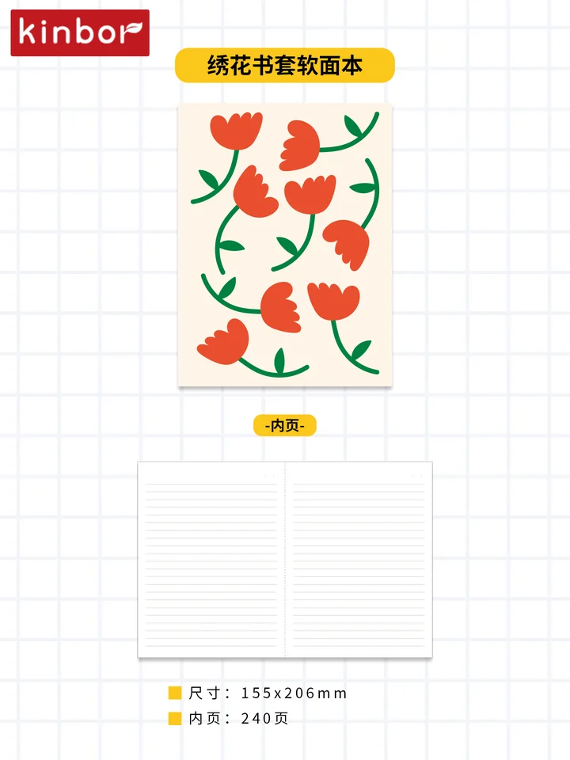
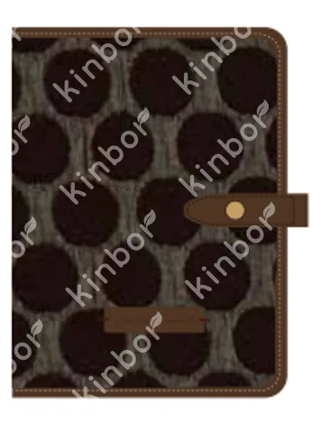
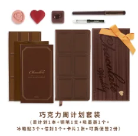
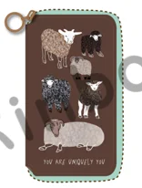

> **Historical Phase 2 artifact.** This brief and its PDF preserve the original 124-unit selection and obsolete numeric ranking. Use the [current reproducible Atlas brief](pilots/atlas/buyer_brief.md) for the new full-catalog audit, candidates and current field evidence. Historical statements below have not all been revalidated.

# Atlas Stationers | Buyer research brief

**Internal review only · 2026-11-09 Chicago / 2026-11-10 UTC · No outreach or confirmed buying interest**

**Verified store facts:** 227 W Lake Street, Chicago, IL 60606 ([contact](https://www.atlasstationers.com/pages/contact-us), R01-E01). The [Schmidt family business](https://www.atlasstationers.com/pages/the-atlas-story) began in 1939 (R01-E02). Official [notebook](https://www.atlasstationers.com/collections/notebooks), [planner](https://www.atlasstationers.com/collections/planners) and [pen storage](https://www.atlasstationers.com/collections/pen-storage) collections support category overlap; notebook filters include Midori, Rhodia, Hobonichi and Leuchtturm1917 (R01-E03–06). Listings are not live-stock verification.

**Match hypothesis:** worth a small human-reviewed assortment conversation if paper/layout and terms check out. Category overlap does not establish buyer interest, equivalence to existing brands or acceptance of Kinbor. Score 86.67; tied with four other shops and fifth only by administrative ID tie-break. New-vendor policy/buyer contact is **Unknown**; general contact is not a verified submission invitation.

| Preview | Actual SKU / name-based English descriptor (inferred) | Why review (inferred) | Units / full carton |
|---|---|---|---|
|  | **DT54729** · Embroidered book-jacket softcover notebook | Notebook family; tactile design may add variety (R01-E03). | 24 |
|  | **DTYC0034** · A6 journal, Time / Tree Rings | Journal family; actual binding/interior and refill fit require inspection (R01-E03). | 40 |
|  | **DT56033** · Chocolate weekly-planning set | Planning/gifting adjacency; dated year, layout and set contents unverified (R01-E04). | 20 |
|  | **DTYC0145** · Weekly zipper pouch, Sheep / Brown | Storage adjacency; pen/planner dimensions and fit unknown (R01-E05). | 40 |

**Order constraint:** one full carton **per individual SKU**; all four candidates = **4 cartons / 124 units**. This is a project rule, not independently verified supplier or buyer agreement. Split/mixed cartons, current supply, landed price, margins, lead times and U.S. resale authority are Unknown. These are candidates to review, not a suggested firm order.

**Questions before an offer:** Does the buyer want illustrated journals/planning sets or only tested writing papers? What language/layout, paper performance and price band are required? Is 20–40 units per selected SKU viable, and what is the correct submission route? Request supplier samples and terms first; do not claim fountain-pen performance or nominal-size compatibility.

**Evidence and rights:** TinyFish [live run receipt](https://agent.tinyfish.ai/runs/98bb203b-8683-4485-8f7b-fc157e5c2a3b) completed; accepted store facts cross-checked against official pages. Exact provider-reported product links remain unconfirmed/rate-limited and unused here. See `evidence.csv` for URL-level retrieval timestamps and `sku_matches.csv` for Chinese source names/rows. Product/carton source: unchanged 2026-10-16 Phase 1 snapshot. Image publication permission is reported by the owner; underlying documents and U.S. resale rights are not verified. Images/trademarks retain their owners' rights.
