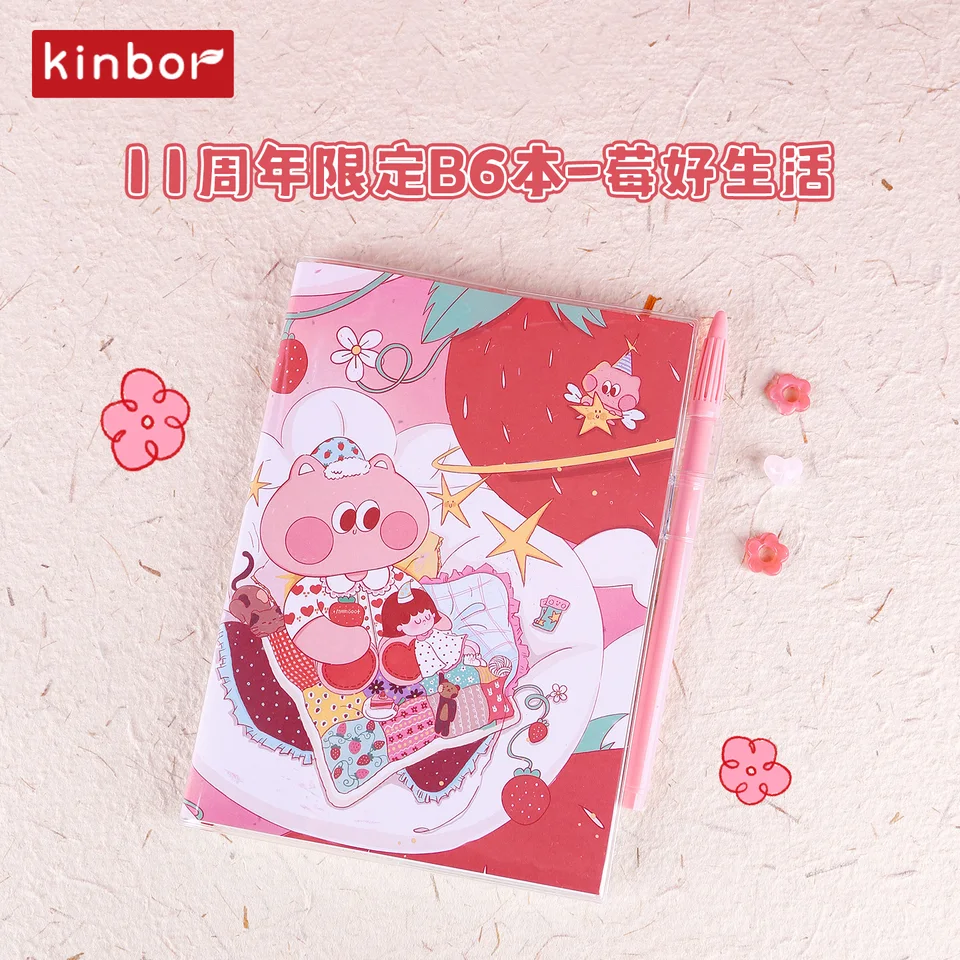

# Retailer research brief

Website: https://www.atlasstationers.com/
Acquisition: `fetch_content`. Status: **completed**. Actual run ID: None (page fetch has no browser-run ID).

This is a research preview. No outreach, forms or purchases occurred.
All **210** catalog SKUs were evaluated; **97** have observed category overlap. The following source-order preview contains tied candidates; it is not a best-seller or buyer-intent ranking.

| Dimension | Observation |
|---|---|
| Product Fit | Category overlap; human review required |
| Evidence Strength | Official page observations; not independent verification |
| Buyer Access | General contact only |
| Order Feasibility | Unknown |

Related real TinyFish browser run: `6b4f0d4a-3a0c-408d-9c1e-ac8736576472`. This separate receipt supports the review; imported field quotes below were fetched with `fetch_content`, which has no browser-run ID.

| SKU | Inferred category | Minimum per SKU | Evidence |
|---|---|---|---|
| DTYC0150 | Notebooks & Journals | 1 carton / 60 units | [E001|E007](https://www.atlasstationers.com/collections/notebooks) |
| DTYC0045 | Planners & Calendars | 1 carton / 80 units | [E004](https://www.atlasstationers.com/collections/planners) |
| DTYC0046 | Planners & Calendars | 1 carton / 80 units | [E004](https://www.atlasstationers.com/collections/planners) |
| DTYC0047 | Planners & Calendars | 1 carton / 80 units | [E004](https://www.atlasstationers.com/collections/planners) |

### DTYC0150 — 莓好生活-11周年限定B6本

Observed Notebooks & Journals category. Catalog name/category implies product-family overlap only; source-order preview among tied eligible candidates.
Source: `原创-在售产品`, row 3. Aesthetic fit: **Needs human image review**. MOQ: one full carton, 60 units. Order feasibility: **Unknown**.

### DTYC0045 — 周计划-大自然的诗

Observed Planners & Calendars category. Catalog name/category implies product-family overlap only; source-order preview among tied eligible candidates.
Source: `原创-在售产品`, row 10. Aesthetic fit: **Needs human image review**. MOQ: one full carton, 80 units. Order feasibility: **Unknown**.

### DTYC0046 — 周计划-自由

Observed Planners & Calendars category. Catalog name/category implies product-family overlap only; source-order preview among tied eligible candidates.
Source: `原创-在售产品`, row 11. Aesthetic fit: **Needs human image review**. MOQ: one full carton, 80 units. Order feasibility: **Unknown**.

### DTYC0047 — 周计划-抱树

Observed Planners & Calendars category. Catalog name/category implies product-family overlap only; source-order preview among tied eligible candidates.
Source: `原创-在售产品`, row 12. Aesthetic fit: **Needs human image review**. MOQ: one full carton, 80 units. Order feasibility: **Unknown**.

## Evidence and unknowns

See `evidence.csv` for exact quotes, field-level source URLs, retrieval timestamps and confidence. `research.json` retains the captured page excerpts used to check those quotes. Unknown means not established within this bounded capture, not absent from the website.

Human review must check the actual image, paper, language/layout, styling, dimensions, resale authority, supplier availability, costs and buyer acceptance of one carton per individual SKU. A general contact page is not permission for a vendor pitch. Read every submission condition on the source page before any action. No automatic aesthetic or buying-intent conclusion is made.
